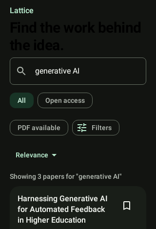
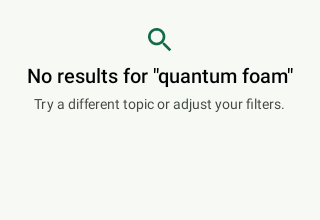
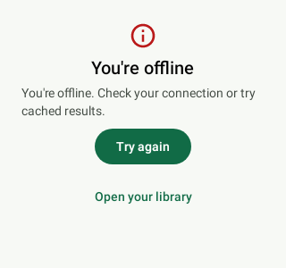

# PaperReader

An account-free Jetpack Compose Android app for discovering scholarly papers, seeing conservative,
backend-verified access information, and keeping useful results locally — built as a demonstration
of a production-shaped MVVM/Compose architecture ahead of a real backend integration.

> **The `demo` build runs entirely on placeholder data.** Every search result, paper, access state,
> and downloaded file it shows comes from a deterministic fake data source and a simulated download
> pipeline — see [Placeholder behavior](#placeholder-behavior-read-this-first) before treating
> anything you see as real bibliographic data or a real PDF.
>
> Two other builds talk to a real PaperReader backend over HTTP: `production`, pinned to the
> deployed service at `https://barretolab.tech/`, and `integration`, which points wherever you aim
> it. Both are separate product flavors, not runtime switches, and neither can fall back to demo
> data — the fakes are not on their classpath. They have been verified end to end against a real
> server; live *release* is still gated on the deprecation-window policy (SHR-003) and on
> server-side PDF verification (API-001) — see [Build modes](#build-modes) and
> [Live-backend status](#live-backend-status).

## Screenshots

All screenshots below are genuine renders of the app's actual Compose code (captured by the
Roborazzi screenshot tests under `app/src/test/screenshots/`), not mockups.

| Search (reference look) | Confirmed PDF | Confirmed open access | No accessible full text |
|---|---|---|---|
|  |  |  |  |

| Loading | Empty results | Recoverable error |
|---|---|---|
|  |  |  |

Note the third and fourth card screenshots: a paper with no confirmed free full text renders with
**no** badge, lock, source link, or button at all — only its bibliographic metadata. That's the
product's central access rule, not a missing feature; see [Verified access](#verified-access).

## Demo walkthrough

With no backend configured, the app defaults to fake mode and is fully usable:

1. Launch the app — a "Demo data" banner confirms fake mode is active, and the Search tab loads
   with recent-query suggestions.
2. Search "generative AI". Results appear with title, authors, venue, year, type, citation count,
   and topic; some show **Download PDF** or **Read online**, most show neither.
3. Toggle the **Open access** / **PDF available** filters, enter a publication year, pick a work
   type, and change the sort order — the result set and ordering update accordingly, and each
   filter can be cleared on its own or all at once.
4. Tap a card to open its detail screen (full author list, abstract, the same access action).
5. Tap the bookmark icon to save a paper, then check the Library tab — it appears there with the
   same access rendering rules.
6. Tap **Download PDF** on an eligible paper, then check the Downloads tab: queued → running
   (simulated progress) → completed, with cancel/retry available mid-flight. The completed item is
   clearly labeled as a demo placeholder, not a real PDF (see below).
7. Turn on airplane mode and relaunch: previously loaded search results and saved papers are still
   visible from the local Room cache, with a stale-data notice and a refresh action.

## Placeholder behavior (read this first)

- **Search/paper data** comes from `FakePaperRemoteDataSource` (in `src/demo/`, so it ships only in
  demo builds), which reads fixture JSON through
  the *same* DTOs, serializers, mappers, and Room persistence a real backend response would use —
  see [`docs/backend/demo-mode.md`](docs/backend/demo-mode.md) for exactly how that works and how
  to point the app at a real backend later.
- **Downloaded files are never real PDFs.** The placeholder download pipeline writes a small
  disclaimer text file and simulates queue/progress/failure/cancel/retry through persisted download
  records; the Downloads screen visibly labels any completed placeholder item as a demo file. The
  production download path (`PdfDownloadWorker`, MIME/`%PDF-` signature validation) exists and is
  tested, but is only exercised once a backend supplies a confirmed PDF descriptor.
- **No OpenAlex key or direct OpenAlex call exists in this app**, in either flavor. Two
  repository-wide Gradle checks (`checkNoOpenAlexSecret`, wired into `:app:check`, and
  `checkNoOpenAlexSecretInArtifacts`, which runs after every `assemble*`) fail the build if one is
  ever introduced — see [`docs/backend/api-contract.md`](docs/backend/api-contract.md) for what a
  real backend is expected to own instead.

## Build modes

The backend mode is a property of the build, never inferred at runtime from whether configuration
happens to be complete. Three flavors: fixtures, a backend you choose, and the deployed one.

| | `demo` | `integration` | `production` |
|---|---|---|---|
| Remote source | `FakePaperRemoteDataSource` | `HttpPaperRemoteDataSource` | `HttpPaperRemoteDataSource` |
| Download gateway | `FakeDownloadManager` (simulated) | `WorkManagerDownloadGateway` (real transfers) | `WorkManagerDownloadGateway` (real transfers) |
| Where the fakes live | `src/demo/` | **nowhere** — not on the classpath | **nowhere** — not on the classpath |
| Backend URL | not used | `-PpaperReaderBackendBaseUrl=<url>`, else the deployed one | `https://barretolab.tech/`, a build constant |
| Can it be redirected? | n/a | yes, that is the point | **no** — it reads no property |
| `applicationId` | `…paperReader.demo` | `…paperReader.integration` | `com.example.paperReader` |
| `INTERNET` permission | not declared | declared | declared |
| Cleartext | none | debug only, loopback hosts only | **none, in either build type** |
| Invalid URL | n/a | assembly fails with an actionable message | assembly fails with an actionable message |

`integration` and `production` compile the same wiring from `src/http/` — one Hilt module, one
`INTERNET` declaration, one set of binding assertions. They differ in where the address comes from,
and deliberately nowhere else.

```bash
# Demo: no backend, no network.
./gradlew :app:assembleDemoDebug
./gradlew :app:verifyDemo                 # assemble + JVM tests + lint

# Production: the deployed backend. Takes no arguments, and ignores any you set.
./gradlew :app:assembleProductionDebug
./gradlew :app:verifyProduction

# Integration: the deployed backend too, unless you point it somewhere else.
./gradlew :app:assembleIntegrationDebug -PpaperReaderBackendBaseUrl=http://10.0.2.2:8080
./gradlew :app:verifyIntegration        -PpaperReaderBackendBaseUrl=http://10.0.2.2:8080

# Everything, all three flavors, plus the source and packaged-artifact secret scans.
./gradlew :app:verifyAllFlavors
```

### Running from Android Studio

Android Studio selects **`demoDebug`** by default, because `demo` sorts first alphabetically. That
is the usual reason the app shows fixture data when you expected a live backend.

1. **Pick the variant.** Build → Select Build Variant… (or the *Build Variants* panel on the left
   edge) → set `app` to `productionDebug` for the deployed backend, or `integrationDebug` if you are
   running a server locally.
2. **Only for a local server:** the Run ▶ button has nowhere to pass `-P`, so put the address where
   Gradle finds it on its own — add one line to `~/.gradle/gradle.properties` (machine-global, never
   committed):

   ```properties
   paperReaderBackendBaseUrl=http://10.0.2.2:8080
   ```

   This affects `integration` only. `production` reads no property, so nothing you put here can
   move it off the deployed backend — which is the whole reason it is a separate flavor.
3. **Run ▶.**

Two things to know:

- **`integrationRelease` needs an explicit https override** if the properties file holds a cleartext
  address: `./gradlew :app:assembleIntegrationRelease -PpaperReaderBackendBaseUrl=https://…`. A
  `-P` flag always wins over the properties file. `productionRelease` needs no such care.
- **The three flavors install as three separate apps** — `com.example.paperReader.demo`,
  `com.example.paperReader.integration`, and `com.example.paperReader` — so they coexist on a
  device. If you have run more than one, there are multiple launcher icons; check which one you are
  opening before concluding the backend is not wired up. The version name carries the same
  distinction (`1.0-demo`, `1.0-integration`, plain `1.0` for production).

Omitting the URL is not a failure any more — `integration` falls back to the deployed backend rather
than refusing to build. What it will never do is fall back to *demo data*; an HTTP flavor has no
fixture implementation on its classpath to fall back to. If you meant to hit a local server and
forgot the property, you will notice because the results are real.

A genuinely unusable address still stops the build:

```
> Cannot assemble integrationDebug: "http://api.example.com" is cleartext for a host outside
  the debug loopback allowlist (10.0.2.2, localhost, 127.0.0.1). Use https for any other host.
```

### Reaching a local server

`integrationDebug` — and only `integrationDebug` — carries a network-security configuration that
permits cleartext to three loopback development hosts. Any other host must use HTTPS, in debug as
well as release.

| Target | Backend URL | Setup |
|---|---|---|
| Emulator | `http://10.0.2.2:8080` | `10.0.2.2` is the host machine as seen from the emulator |
| Physical device over USB | `http://localhost:8080` | `adb reverse tcp:8080 tcp:8080` first |
| Anything else | `https://...` | no cleartext exception exists for it |

### Release transport

`integrationRelease`, `productionDebug` and `productionRelease` accept only an HTTPS base URL and
contain no cleartext exception. `integrationDebug` is the sole exception, and only for the loopback
hosts above. Both halves are checked:

```bash
./gradlew :app:assembleIntegrationRelease -PpaperReaderBackendBaseUrl=http://api.example.com
# > Cannot assemble integrationRelease: "http://api.example.com" is cleartext.
#   This build must use https.

./gradlew :app:verifyIntegrationReleaseNetworkPolicy -PpaperReaderBackendBaseUrl=https://api.example.com
# > integrationRelease: Internet permission present, no cleartext exception.

# Production is held to the release standard in its debug build too — it has no loopback story.
./gradlew :app:verifyProductionDebugNetworkPolicy :app:verifyProductionReleaseNetworkPolicy
# > productionDebug: Internet permission present, no cleartext exception.
# > productionRelease: Internet permission present, no cleartext exception.
```

### Signing a production release

`assembleProductionRelease` refuses to produce an unsigned artifact. Generate a keystore once, keep
it outside the repository (`*.jks` and `*.keystore` are git-ignored regardless), and put the four
properties in `~/.gradle/gradle.properties`:

```bash
keytool -genkeypair -v -keystore ~/keys/paperreader-release.jks \
  -alias paperreader -keyalg RSA -keysize 4096 -validity 10000
```

```properties
paperReaderReleaseStoreFile=/Users/you/keys/paperreader-release.jks
paperReaderReleaseStorePassword=…
paperReaderReleaseKeyAlias=paperreader
paperReaderReleaseKeyPassword=…
```

Without them, every other variant still builds; only `productionRelease` stops:

```
> Cannot assemble productionRelease: release signing is not configured. Set
  paperReaderReleaseStoreFile, paperReaderReleaseStorePassword, paperReaderReleaseKeyAlias,
  paperReaderReleaseKeyPassword in ~/.gradle/gradle.properties; they must never be committed.
```

## Live-backend status

| Capability | Status |
|---|---|
| Demo mode (search, detail, library, simulated downloads, offline cache) | works today |
| Integration build, network permission, local HTTP development route | implemented |
| Production build pinned to the deployed service | **implemented 2026-09-12** — `https://barretolab.tech/`, verified below |
| Request/response/error semantics against a pinned v1 contract | implemented and tested |
| Real bibliographic results and real access resolution | **verified 2026-09-09** against a running server — see below |
| Shared consumer/provider contract verification (SHR-001/SHR-002) | **closed 2026-09-09** — both repositories verify `paperreader-v1.0.0` |
| Server-side verification that a `DIRECT_PDF` is actually reachable | **accepted debt (API-001)**, owned by the server |
| v1 deprecation window / minimum-client policy (SHR-003) | **blocked** — needs release-management agreement |

Both HTTP builds have now been run end to end against a real PaperReader server. The
`production` build reached the deployed service at `https://barretolab.tech/` on 2026-09-12:
`atdProductionDebugAndroidTest` was 29/29 on a build-managed Pixel 6 emulator with **none skipped**,
which is the part that matters — `RealBackendSmokeTest` skips when nothing is listening, so a full
run is proof the deployment answered. Its seven cases verified live search, cursor advancement
without overlap, paper detail identity, `DIRECT_PDF` descriptor confirmation over HTTPS, the
`200 + descriptor:null` no-PDF outcome, `404 → NotFound`, and a PDF-only search inside the client
timeout. Run it yourself, or point a debug build at your own server:

```bash
# The deployed backend:
./gradlew :app:atdProductionDebugAndroidTest

# Or your own server:
./gradlew :app:atdIntegrationDebugAndroidTest -PpaperReaderBackendBaseUrl=http://10.0.2.2:8080
```

The suite lives in `src/androidTestHttp/` and runs under both flavors. It skips rather than fails
when no server is listening.

`TECHNICAL_DEBT.md` is the authoritative register; `docs/api-compatibility.md` records the pinned
contract version and the rules for changing it;
[`docs/android-debt-verification-matrix.md`](docs/android-debt-verification-matrix.md) maps each
register item to the exact check that closes it.

### Controlled end-to-end check

`app/src/androidTestIntegration/.../LiveBackendConnectivityTest.kt` runs a local HTTP server on the
device itself. It stays integration-only, because the cleartext loopback route it proves is
something only `integrationDebug` is entitled to. It serves the pinned contract fixtures over the
documented loopback host, and completes a **validated** PDF transfer (a body that is not a real PDF is rejected even on a `200`). It needs
a connected device or emulator, and carries no credential of any kind:

```bash
./gradlew :app:connectedIntegrationDebugAndroidTest -PpaperReaderBackendBaseUrl=http://10.0.2.2:8080
```

## Verified access

An access action is shown **only** for a paper whose normalized access state is a backend-confirmed
`DIRECT_PDF` (valid HTTPS download descriptor) or `OPEN_FULL_TEXT` (valid HTTPS source URL). Every
other state — not free, paywalled, unknown, still checking, or a failed verification — renders with
no badge, lock, source link, or button, on every screen that shows a paper (search, detail, saved
library). This fail-closed mapping happens in exactly one place
(`ui/components/AccessPresentation.kt`'s `toAccessAction()`), is re-applied every time a paper is
re-read from the local Room cache (not just on a fresh network response), and a cached actionable
state older than 24h is downgraded to "unknown" rather than trusted indefinitely. See
[`docs/backend/api-contract.md`](docs/backend/api-contract.md#the-access-state-contract) for the
full state table.

## Architecture highlights

- **Compose + MVVM + Hilt**, unidirectional `StateFlow<UiState>`, Room as the local source of truth
  for both cache and user-owned data (saved papers, downloads). Full breakdown in
  [`docs/architecture.md`](docs/architecture.md).
- **Backend-ready data layer**: `PaperRemoteDataSource` is implemented by both
  `FakePaperRemoteDataSource` and `HttpPaperRemoteDataSource`, selected by product flavor at
  **compile time** — each flavor's Hilt module binds its own, so the fakes are not on an integration
  build's classpath at all. One scenario matrix (`RemoteModeParityTest`) asserts both produce the
  same repository-level outcomes.
- **Cursor-based pagination** throughout, no page numbers. A query-scoped cursor session traverses a
  bounded number of empty pages, detects a repeated cursor, and never presents "no matches" while a
  cursor remains.
- **Transfer-time download confirmation**: every initial and retried download re-fetches the
  descriptor from `GET /v1/papers/{id}/download` and enqueues only from that fresh, validated,
  unexpired HTTPS result — never from one cached in a paper or download record.
- **Material 3 theme** derived from `docs/ui/lattice-search-reference.png` — see design.md decision
  7 for how literally that reference is followed.
- Per-capability behavior specs (given/when/then) live under
  [`openspec/specs/`](openspec/specs/); the design rationale for the original milestone is archived
  at
  [`openspec/changes/archive/2026-09-08-build-openalex-paper-reader/design.md`](openspec/changes/archive/2026-09-08-build-openalex-paper-reader/design.md).
  Work in progress lives under [`openspec/changes/`](openspec/changes/).

## Running it

```bash
./gradlew :app:assembleDemoDebug                # build the demo APK
./gradlew :app:testDemoDebugUnitTest            # JVM unit + Robolectric + screenshot tests
./gradlew :app:verifyApiContract                # pinned v1 consumer-contract + fake/HTTP parity
./gradlew :app:atdDemoDebugAndroidTest          # instrumented/Compose tests on a managed emulator
./gradlew :app:lintDemoDebug                    # Android lint
./gradlew checkNoOpenAlexSecret                 # repository-wide secret scan (also part of :app:check)
```

Every task name now carries a flavor: `testDemoDebugUnitTest` and `testIntegrationDebugUnitTest`
rather than `testDebugUnitTest`. See [Build modes](#build-modes) for the integration equivalents.

### Instrumentation tests

Instrumentation runs on a **build-managed device** declared in `app/build.gradle.kts`, so there is
no emulator to create or boot by hand — Gradle downloads the image, starts it, runs the tests, and
tears it down:

```bash
./gradlew :app:atdDemoDebugAndroidTest
./gradlew :app:atdProductionDebugAndroidTest
./gradlew :app:atdIntegrationDebugAndroidTest -PpaperReaderBackendBaseUrl=http://10.0.2.2:8080
./gradlew :app:verifyConnected                                                    # all three
```

The device is a Pixel 6 on API 33 using an **`aosp-atd`** image — an Automated Test Device with no
Play Store, GMS or SystemUI, which removes the background services that make instrumentation flaky
and keeps the image light. On Apple Silicon the `arm64-v8a` variant is selected automatically, so it
runs natively without Rosetta. Its AVD is created under `~/.android/avd/gradle-managed/` and does
not touch any AVD you created yourself.

Any hand-made AVD still works the usual way if you want an interactive device — start it from
Android Studio's Device Manager (or `$ANDROID_HOME/emulator/emulator -avd <name>`) and use
`./gradlew :app:connectedDemoDebugAndroidTest`. That is the better choice for a manual walkthrough,
where a Play-Store image is closer to production than an ATD image is.

The Android SDK command-line tools are not on `PATH` by default on a fresh Android Studio install.
If `adb` is not found:

```bash
export ANDROID_HOME="$HOME/Library/Android/sdk"
export PATH="$ANDROID_HOME/platform-tools:$ANDROID_HOME/emulator:$PATH"
```

Re-record screenshot goldens after an intentional UI change with
`./gradlew :app:recordRoborazziDemoDebug`, then review the diffs under
`app/src/test/screenshots/` like any other source change.

minSdk 26, target/compile SDK 36, Kotlin `2.2`, no authentication or user accounts.

## Limitations

- The **demo** build has no real bibliographic search results, verified access, or downloadable
  PDFs, by design — see [Placeholder behavior](#placeholder-behavior-read-this-first). The
  **integration** build does, against a running PaperReader server; see
  [Live-backend status](#live-backend-status).
- PDF availability is derived by the server from OpenAlex metadata, not verified against the actual
  remote document. This is accepted debt (API-001), owned by the server; a `DIRECT_PDF` can
  therefore still point at a dead link or a landing page. The client's own download validation
  (`%PDF-` signature plus a successful response) is what catches that today.
- Both repositories now verify the same `paperreader-v1.0.0` bundle, so a green contract suite does
  mean the two sides agree about the pinned version. What is *not* yet automated is noticing that
  the provider has published a **newer** version: a stale vendored copy is internally consistent and
  passes. Re-vendoring is deliberate — see `docs/api-compatibility.md`.
- No accounts, cross-device sync, annotations, or citation management (explicitly out of scope —
  see the proposal's Non-Goals).
- Instrumented/Compose UI tests boot an emulator, so they are not part of
  `:app:testDemoDebugUnitTest` and need a machine with hardware virtualization available.
